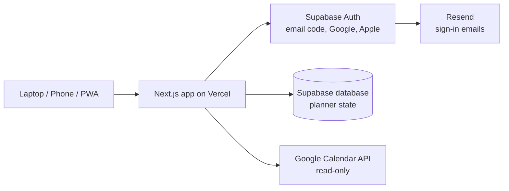

# 🌙 Aurea Planner

**One calm place for your tasks, projects, routines, and calendar, synced across laptop and phone.** 

### [Try the live app](https://my-aurea-planner.vercel.app) 


 

---

## Why I built it 

I was juggling a to-do app, a project board, a habit tracker, and a calendar, and none of them talked to each other. Aurea's core idea is that **one item shows up everywhere it belongs without being duplicated**: a project task lives in its project, appears on Today when it's due, and lands on the schedule when it has a time. 

I use it every day, and it has gone through 6+ versions driven by my own feedback and friends' testing. 

## What it does 

| | |
|---|---|
| **Today** | Unscheduled tasks next to a timeline; drag tasks onto the schedule; an evening review to roll unfinished tasks forward |
| **Projects** | Kanban board (To Do → In Progress → Done), undated backlog, checklists, progress tracking, update log |
| **Routines** | Repeating habits with their own checklists; they never auto-complete, so you always check them yourself |
| **Calendar** | Monthly view, Google Calendar sync, `.ics` import |
| **Everywhere** | Cloud sync across devices, installable on iPhone home screen, 4 themes, custom categories |
 
## Built with
 
**Next.js · TypeScript · Supabase** (auth + database) **· Vercel** (hosting) **· Resend** (email) **· Google Calendar API**
 

 
## Interesting problems I solved
 
- **Recurring items:** daily, weekdays, weekly on chosen days, monthly, yearly, or custom, with "delete this one / this and future / whole series"
- **Time-zone-aware auto-completion:** scheduled tasks complete themselves after their end time in the user's chosen time zone, including overnight and multi-day tasks
- **Timelines past midnight:** a day's schedule can extend into early next morning without breaking the next day's view
- **Phone sign-in:** switched home-screen sign-in to a one-time code because magic links opened a separate Safari tab
- **Linked completion:** checking every subtask completes the parent; reopening one reopens it, and the state stays in sync across all views
## How I built it
 
I owned the product design, feature decisions, data model, and testing, and built the code using AI-assisted development. Every feature in this README came from a real problem I hit while using the app.
 
## What's next
 
- Refine Google Calendar sync and cross-device testing
- Native iPhone/iPad app for Apple Calendar access, widgets, and reliable notifications ([plan](docs/NATIVE-APP-PLAN.md))
## Run locally
 
```bash
npm install
npm run dev   # http://localhost:3000
```
 
Requires `NEXT_PUBLIC_SUPABASE_URL` and `NEXT_PUBLIC_SUPABASE_PUBLISHABLE_KEY`. Full setup: [docs/SETUP.md](docs/SETUP.md) · Version history: [docs/CHANGELOG.md](docs/CHANGELOG.md)
 
---
 
Made by [Angelyne Susanto](https://github.com/angelynes) · [LinkedIn](https://www.linkedin.com/in/angelyne-susanto/) 
